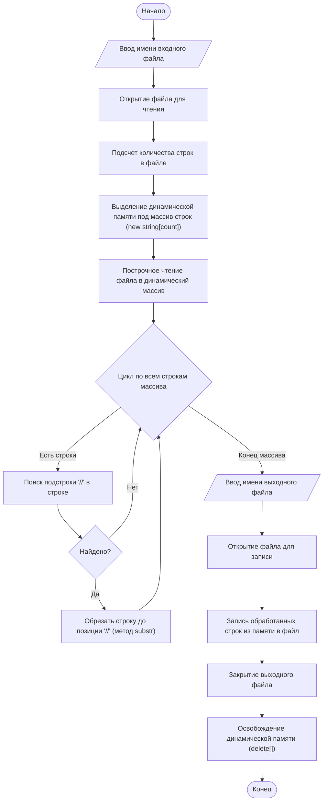

# Лабораторная работа №10. Обработка текстовых файлов и динамическая память

**Дисциплина:** Алгоритмизация и программирование  
**Вариант:** 8  

## Цель работы

Изучение механизмов работы с файловыми потоками ввода-вывода в языке C++, освоение правил выделения и освобождения динамической памяти для массивов объектов, а также приобретение практических навыков построчной обработки текстовых данных и манипулирования строками в оперативной памяти.

## Постановка задачи

Написать программу, считывающую символьный файл в динамическую память целиком построчно, формируя массив строк. Удалить из всех строк однострочные комментарии `//` (в памяти) и записать результат в новый файл, имя которого вводится с клавиатуры. Программа должна быть разделена на три файла: заголовочный файл, файл реализации и главный файл программы.

## Описание алгоритма и структура проекта

1. **Первичное чтение входного файла:** Программа открывает исходный файл `code.txt` с помощью объекта `std::ifstream` и в цикле подсчитывает полное количество строк для определения точного размера динамического массива.
2. **Выделение памяти:** После сброса флагов состояния потока и возврата указателя чтения в начало файла (`clear()` и `seekg(0)`), оператором `new` выделяется динамическая память под массив строк `std::string` вычисленного размера.
3. **Заполнение массива:** Строки файла считываются последовательно и сохраняются в выделенные ячейки памяти.
4. **Фильтрация комментариев в памяти:** Программа обходит полученный динамический массив. В каждой строке методом `find("//")` выполняется поиск позиции начала однострочного комментария. Если комментарий обнаружен, строка усекается методом `substr(0, pos)`, оставляя только содержательный код.
5. **Запись результата:** Программа запрашивает у пользователя имя нового файла, создает его через `std::ofstream` и последовательно выгружает измененный массив строк на диск.
6. **Очистка ресурсов:** Динамический массив строк удаляется из памяти оператором `delete[]` во избежание утечек памяти.

Проект разделен на три файла в папке `src/`:
* **`src/my_lab10.h`** — заголовочный файл с объявлениями функций чтения, обработки и записи.
* **`src/my_lab10.cpp`** — реализация логики работы с файловыми потоками, динамическим массивом и фильтрацией строк.
* **`src/main10.cpp`** — главный файл программы, создающий демонстрационный файл `code.txt` и управляющий процессом обработки.

## Сборка и запуск

```bash
g++ src/main10.cpp src/my_lab10.cpp -o lab10
./lab10
```

## Результаты выполнения программы

**Содержимое исходного файла (`code.txt`):**
```cpp
int a = 12; // инициализация переменной a
double b = 3.14; // инициализация переменной b
// Полная строка комментария, преобразуется в пустую строку
cout << a + b << endl; // вывод расчетной суммы
```

**Содержимое выходного файла (`clean_code.txt`):**
```cpp
int a = 12; 
double b = 3.14; 

cout << a + b << endl; 
```

**Консольный вывод работы программы:**
```text
[INFO] Входной файл 'code.txt' успешно инициализирован тестовым кодом.
Введите имя файла для записи результата (например, clean_code.txt): clean_code.txt
[SUCCESS] Обработка завершена. Результат сохранен в файл clean_code.txt
```

## Блок-схема



## Вывод

В ходе лабораторной работы были закреплены навыки работы со стандартной библиотекой потокового ввода-вывода `<fstream>`. Были практически изучены особенности жизненного цикла объектов в динамической памяти (операторы `new` и `delete[]`), а также принципы безопасной передачи параметров в функции с использованием ссылочных типов (`&`) и константных модификаторов (`const`). Алгоритм поиска и удаления комментариев в динамической памяти отработал штатно, что подтверждается результатами генерации выходного файла.