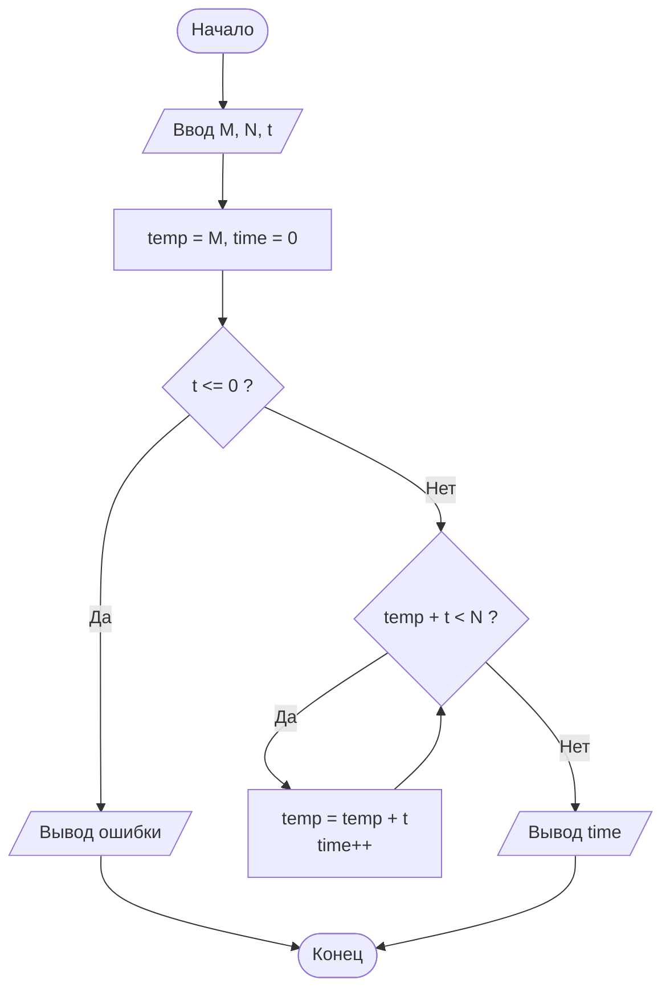

# Лабораторная работа №4: Циклы


Репозиторий содержит выполнение лабораторной работы №4 по дисциплине **«Алгоритмизация и программирование»** (ГУАП, Кафедра № 31).

* **Студент:** Уралов А. М. (гр. 3522)
* **Преподаватель:** Нуйя О. С.
* **Дата:** 05.04.2026

## 1. Цель работы
Приобрести практические навыки работы с операторами повторения (циклами) языка C++.

## 2. Постановка задачи (Вариант 9)

Температура масла в закрытой колбе возрастает с $M$ градусов на $t$ градусов каждую минуту. При достижении значения $N$ градусов возможен разрыв стенок колбы.

Определить предельно допустимое время нагрева масла (в целых минутах), чтобы не допустить разрыва колбы ($\text{temp} < N$).

### Описательный алгоритм
1. Ввести начальную температуру $M$, критическую температуру $N$ и шаг нагрева за минуту $t$.
2. Присвоить начальные значения: $\text{temp} = M$, $\text{time} = 0$.
3. Проверить корректность шага: если $t \le 0$, вывести сообщение об ошибке и завершить работу.
4. Пока выполняется условие $\text{temp} + t < N$:
   * увеличить текущую температуру: $\text{temp} = \text{temp} + t$;
   * увеличить счетчик времени на 1 минуту: $\text{time}++$.
5. Вывести полученное значение $\text{time}$.

## 3. Схема алгоритма



## 4. Исходный код

### Решение на C++ (`src/main.cpp`)

```cpp
#include <iostream>

using namespace std;

int main() 
{
    double M = 0.0, N = 0.0, t = 0.0, temp = 0.0;
    int time = 0;

    cout << "Введите начальную температуру M: ";
    cin >> M;

    cout << "Введите опасную температуру N: ";
    cin >> N;

    cout << "Введите повышение температуры за минуту t: ";
    cin >> t;

    temp = M;

    if (t <= 0) 
    {
        cout << "Некорректное значение t" << endl;
        return 0;
    }

    while (temp + t < N) 
    {
        temp = temp + t;
        time++;
    }

    cout << "Предельно допустимое время нагрева: " << time << " мин." << endl;

    return 0;
}
```

### Решение на C (`src/main.c`)

```c
#include <stdio.h>

int main(void) 
{
    double M = 0.0, N = 0.0, t = 0.0, temp = 0.0;
    int time = 0;

    printf("Введите начальную температуру M: ");
    if (scanf("%lf", &M) != 1) return 1;

    printf("Введите опасную температуру N: ");
    if (scanf("%lf", &N) != 1) return 1;

    printf("Введите повышение температуры за минуту t: ");
    if (scanf("%lf", &t) != 1) return 1;

    temp = M;

    if (t <= 0) 
    {
        printf("Некорректное значение t\n");
        return 0;
    }

    while (temp + t < N) 
    {
        temp = temp + t;
        time++;
    }

    printf("Предельно допустимое время нагрева: %d мин.\n", time);

    return 0;
}
```

## 5. Сборка и запуск

```bash
# Сборка и запуск C++
g++ -O2 src/main.cpp -o run_cpp
./run_cpp

# Сборка и запуск C
gcc -O2 src/main.c -o run_c
./run_c
```

## 6. Тестирование программы

| Тест | Начальная $M$ | Опасная $N$ | Шаг $t$ | Пошаговый нагрев | Результат (`time`) |
| :---: | :---: | :---: | :---: | :--- | :---: |
| **№1** | `20` | `50` | `7` | $20 \to 27 \to 34 \to 41 \to 48$ ($+7 = 55 \ge 50$) | `4 мин.` |
| **№2** | `10` | `25` | `4` | $10 \to 14 \to 18 \to 22$ ($+4 = 26 \ge 25$) | `3 мин.` |
| **№3** | `60` | `50` | `5` | $60 \ge 50$ (нагрев невозможен) | `0 мин.` |

## 7. Вывод

В ходе выполнения лабораторной работы был изучен оператор цикла с предусловием `while`. Разработана программа, определяющая предельно допустимое время нагрева масла в колбе без достижения критической температуры разрыва стенок. Программа корректно обрабатывает как штатные режимы нагрева, так и граничные случаи, когда начальная температура уже превышает допустимую.