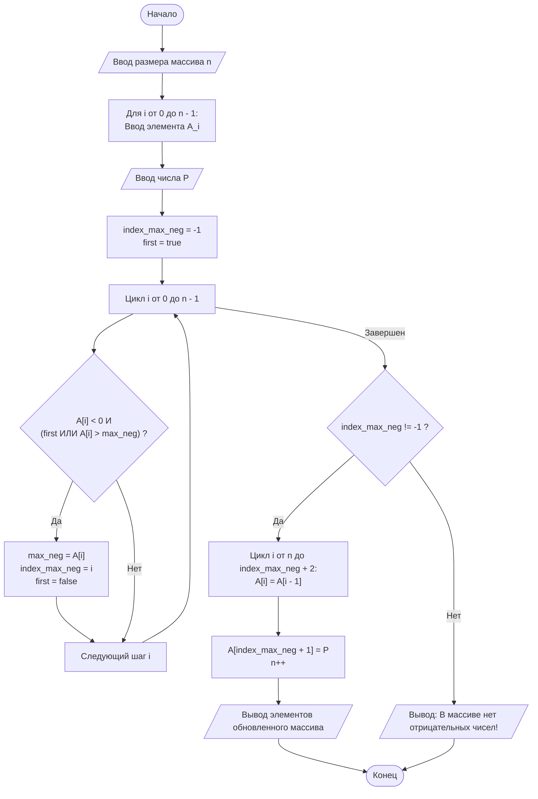

# Лабораторная работа №5: Стандартные алгоритмы работы с одномерными массивами


Репозиторий содержит выполнение лабораторной работы №5 по дисциплине **«Алгоритмизация и программирование»** (ГУАП, Кафедра № 31).

* **Студент:** Уралов А. М. (гр. 3522)
* **Преподаватель:** Нуйя О. С.
* **Дата:** 02.05.2026

## 1. Цель работы
Изучить алгоритмы работы с одномерными массивами, освоить средства языка C++ для описания циклов с параметром и закрепить навыки их использования при программировании, изучить способы описания, ввода-вывода и обработки одномерных массивов.

## 2. Постановка задачи (Вариант 9)

В массиве $A = (a_1, a_2, \dots, a_n)$ вставить новый элемент со значением $P$ вслед за наибольшим из отрицательных элементов этого массива.

### Описательный алгоритм
1. Объявить массив целых чисел с запасом памяти (`MAX_SIZE = 100`).
2. Ввести реальный размер массива $n$ и элементы массива с клавиатуры.
3. Ввести значение $P$ для вставки.
4. Найти наибольший отрицательный элемент в массиве и сохранить его индекс (`index_max_neg`), используя цикл `for` и проверку на первый найденный отрицательный элемент либо элемент, превышающий текущий максимум среди отрицательных.
5. Если отрицательный элемент найден (`index_max_neg != -1`), сдвинуть все элементы массива правее найденного на одну позицию вправо, начиная с конца массива.
6. Вставить элемент $P$ на позицию `index_max_neg + 1` и увеличить размер массива $n$ на единицу.
7. Вывести измененный массив на экран (или сообщение об отсутствии отрицательных элементов).

## 3. Схема алгоритма



## 4. Исходный код

### Решение на C++ (`src/main.cpp`)

```cpp
#include <iostream>

using namespace std;

int main() 
{
    const int MAX_SIZE = 100;
    int A[MAX_SIZE];
    int n = 0, P = 0;

    cout << "Введите размер массива (<= " << MAX_SIZE - 1 << "): ";
    cin >> n;

    cout << "Введите " << n << " элементов массива: ";
    for (int i = 0; i < n; i++) 
    {
        cin >> A[i];
    }

    cout << "Введите число P: ";
    cin >> P;

    int max_neg = 0;
    int index_max_neg = -1;
    bool first = true;

    for (int i = 0; i < n; i++) 
    {
        if (A[i] < 0 && (first || A[i] > max_neg)) 
        {
            max_neg = A[i];
            index_max_neg = i;
            first = false;
        }
    }

    if (index_max_neg != -1) 
    {
        for (int i = n; i > index_max_neg + 1; i--) 
        {
            A[i] = A[i - 1];
        }
        A[index_max_neg + 1] = P;
        n++;

        cout << "Измененный массив: ";
        for (int i = 0; i < n; i++) 
        {
            cout << A[i] << " ";
        }
        cout << endl;
    } 
    else 
    {
        cout << "В массиве нет отрицательных чисел!" << endl;
    }

    return 0;
}
```

### Решение на C (`src/main.c`)

```c
#include <stdio.h>
#include <stdbool.h>

#define MAX_SIZE 100

int main(void) 
{
    int A[MAX_SIZE];
    int n = 0, P = 0;

    printf("Введите размер массива (<= %d): ", MAX_SIZE - 1);
    if (scanf("%d", &n) != 1 || n <= 0 || n >= MAX_SIZE) return 1;

    printf("Введите %d элементов массива: ", n);
    for (int i = 0; i < n; i++) 
    {
        if (scanf("%d", &A[i]) != 1) return 1;
    }

    printf("Введите число P: ");
    if (scanf("%d", &P) != 1) return 1;

    int max_neg = 0;
    int index_max_neg = -1;
    bool first = true;

    for (int i = 0; i < n; i++) 
    {
        if (A[i] < 0 && (first || A[i] > max_neg)) 
        {
            max_neg = A[i];
            index_max_neg = i;
            first = false;
        }
    }

    if (index_max_neg != -1) 
    {
        for (int i = n; i > index_max_neg + 1; i--) 
        {
            A[i] = A[i - 1];
        }
        A[index_max_neg + 1] = P;
        n++;

        printf("Измененный массив: ");
        for (int i = 0; i < n; i++) 
        {
            printf("%d ", A[i]);
        }
        printf("\n");
    } 
    else 
    {
        printf("В массиве нет отрицательных чисел!\n");
    }

    return 0;
}
```

## 5. Сборка и запуск

```bash
# Сборка и запуск C++
g++ -O2 src/main.cpp -o run_cpp
./run_cpp

# Сборка и запуск C
gcc -O2 src/main.c -o run_c
./run_c
```

## 6. Тестирование программы

| Тест | Описание сценария | Размер $n$ | Элементы массива | Число $P$ | Результат работы программы |
| :---: | :--- | :---: | :---: | :---: | :--- |
| **№1** | Нормальная работа со сдвигом | `5` | `10 -100 5 -5 2` | `777` | `Измененный массив: 10 -100 5 -5 777 2` |
| **№2** | Нет отрицательных элементов | `3` | `1 2 3` | `50` | `В массиве нет отрицательных чисел!` |

## 7. Вывод

В ходе выполнения лабораторной работы изучены стандартные алгоритмы работы с одномерными массивами. Написана и протестирована программа, реализующая поиск максимального отрицательного элемента с последующей вставкой нового значения и сдвигом элементов вправо без использования дополнительных массивов.