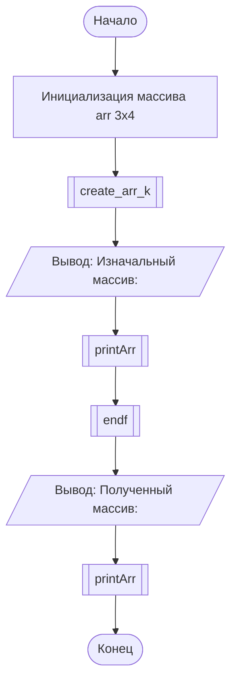

# Лабораторная работа №6: Двумерные массивы


Репозиторий содержит выполнение лабораторной работы №6 по дисциплине **«Алгоритмизация и программирование»** (ГУАП, Кафедра № 31).

* **Студент:** Уралов А. М. (гр. 3522)
* **Преподаватель:** Нуйя О. С.
* **Дата:** 10.05.2026

## 1. Цель работы
Освоить принципы объявления, инициализации, ввода-вывода и обработки двумерных массивов (матриц) с использованием пользовательских функций на языке C++.

## 2. Постановка задачи (Вариант 6)

Дан двумерный массив целых чисел из 4 столбцов и 3 строк. Переставить местами строку, содержащую минимальный элемент, и последнюю строку.

### Описательный алгоритм
1. Объявляются константы размерности матрицы: `a = 3` (строки), `b = 4` (столбцы) и создается двумерный массив `arr[3][4]`.
2. Вызывается функция `create_arr_k(arr)`, которая в двойном вложенном цикле запрашивает с клавиатуры элементы `arr[i][j]`.
3. На экран выводится заголовок `"Изначальный массив: "` и вызывается функция `printArr(arr)` для построчного вывода матрицы.
4. Вызывается функция `endf(arr)`, внутри которой функция `find_minStr(arr)` находит индекс строки `min_inxStr`, содержащей минимальный элемент матрицы.
5. Если `min_inxStr == 2` (минимальный элемент уже находится в последней строке), массив выводится без изменений.
6. Иначе выполняется цикл по всем столбцам (от `0` до `3`), меняющий местами элементы строки `arr[min_inxStr][i]` и последней строки `arr[2][i]`.
7. В функции `main` выводится заголовок `"Полученный массив: "` и итоговое состояние матрицы через `printArr(arr)`.

## 3. Схема алгоритма



## 4. Исходный код

### Решение на C++ (`src/main.cpp`)

```cpp
#include <iostream>
#include <random>
#include <ctime>
#include <algorithm>

using namespace std;

const int a = 3, b = 4;

// Прототипы функций
void create_arr_k(int arr[a][b]);
void printArr(int arr[a][b]);
int find_minStr(int arr[a][b]);
void endf(int arr[a][b]);
void create_arr_R(int arr[a][b]);

int main() 
{
    int arr[a][b];

    create_arr_k(arr);
    cout << "Изначальный массив: " << endl;
    printArr(arr);

    endf(arr);
    cout << "Полученный массив: " << endl;
    printArr(arr);

    return 0;
}

// Функция заполнения массива случайными числами
void create_arr_R(int arr[a][b]) 
{
    srand(time(NULL));
    for (int i = 0; i < a; i++) 
    {
        for (int j = 0; j < b; j++) 
        {
            arr[i][j] = 1 + rand() % 25;
        }
    }
}

// Функция вывода массива
void printArr(int arr[a][b]) 
{
    for (int i = 0; i < a; i++) 
    {
        for (int j = 0; j < b; j++) 
        {
            cout << arr[i][j] << " ";
        }
        cout << endl;
    }
}

// Функция поиска индекса строки с минимальным элементом
int find_minStr(int arr[a][b]) 
{
    int min = arr[0][0], min_inxStr = 0;
    for (int i = 0; i < a; i++) 
    {
        for (int j = 0; j < b; j++) 
        {
            if (arr[i][j] < min) 
            {
                min = arr[i][j];
                min_inxStr = i;
            }
        }
    }
    return min_inxStr;
}

// Функция перестановки строк массива
void endf(int arr[a][b]) 
{
    int min_inxStr = find_minStr(arr);
    if (min_inxStr == 2) 
    {
        cout << endl;
        printArr(arr);
    } 
    else 
    {
        for (int i = 0; i < b; i++) 
        {
            swap(arr[min_inxStr][i], arr[2][i]);
        }
    }
}

// Функция заполнения массива с клавиатуры
void create_arr_k(int arr[a][b]) 
{
    for (int i = 0; i < a; i++) 
    {
        for (int j = 0; j < b; j++) 
        {
            cout << "arr [" << i + 1 << "][" << j + 1 << "]: ";
            cin >> arr[i][j];
        }
    }
}
```

### Решение на C (`src/main.c`)

```c
#include <stdio.h>
#include <stdlib.h>
#include <time.h>

#define A 3
#define B 4

void create_arr_k(int arr[A][B]);
void printArr(int arr[A][B]);
int find_minStr(int arr[A][B]);
void endf(int arr[A][B]);

int main(void) 
{
    int arr[A][B];

    create_arr_k(arr);
    printf("Изначальный массив:\n");
    printArr(arr);

    endf(arr);
    printf("Полученный массив:\n");
    printArr(arr);

    return 0;
}

void printArr(int arr[A][B]) 
{
    for (int i = 0; i < A; i++) 
    {
        for (int j = 0; j < B; j++) 
        {
            printf("%d ", arr[i][j]);
        }
        printf("\n");
    }
}

int find_minStr(int arr[A][B]) 
{
    int min = arr[0][0], min_inxStr = 0;
    for (int i = 0; i < A; i++) 
    {
        for (int j = 0; j < B; j++) 
        {
            if (arr[i][j] < min) 
            {
                min = arr[i][j];
                min_inxStr = i;
            }
        }
    }
    return min_inxStr;
}

void endf(int arr[A][B]) 
{
    int min_inxStr = find_minStr(arr);
    if (min_inxStr == 2) 
    {
        printf("\n");
        printArr(arr);
    } 
    else 
    {
        for (int i = 0; i < B; i++) 
        {
            int temp = arr[min_inxStr][i];
            arr[min_inxStr][i] = arr[2][i];
            arr[2][i] = temp;
        }
    }
}

void create_arr_k(int arr[A][B]) 
{
    for (int i = 0; i < A; i++) 
    {
        for (int j = 0; j < B; j++) 
        {
            printf("arr [%d][%d]: ", i + 1, j + 1);
            if (scanf("%d", &arr[i][j]) != 1) exit(1);
        }
    }
}
```

## 5. Сборка и запуск

```bash
# Сборка и запуск C++
g++ -O2 src/main.cpp -o run_cpp
./run_cpp

# Сборка и запуск C
gcc -O2 src/main.c -o run_c
./run_c
```

## 6. Тестирование программы

### Тест 1 (Минимальный элемент `1` в 3-й строке — строка уже последняя)
* **Изначальный массив:**
  ```text
  5 8 2 9
  15 11 14 20
  7 1 12 3
  ```
* **Полученный массив:**
  ```text
  5 8 2 9
  15 11 14 20
  7 1 12 3
  ```

### Тест 2 (Минимальный элемент `1` в 3-й строке — строка уже последняя)
* **Изначальный массив:**
  ```text
  10 20 30 40
  9 15 25 35
  1 2 3 4
  ```
* **Полученный массив:**
  ```text
  10 20 30 40
  9 15 25 35
  1 2 3 4
  ```

### Тест 3 (Минимальный элемент `1` во 2-й строке — обмен 2-й и 3-й строк)
* **Изначальный массив:**
  ```text
  8 3 12 6
  1 10 99 4
  15 22 7 11
  ```
* **Полученный массив:**
  ```text
  8 3 12 6
  15 22 7 11
  1 10 99 4
  ```

## 7. Вывод

В ходе выполнения лабораторной работы изучены методы обработки двумерных массивов и передачи матриц в пользовательские функции. Реализована и протестирована программа, выполняющая поиск минимального элемента в матрице $3 \times 4$ и перестановку содержащей его строки с последней строкой массива.