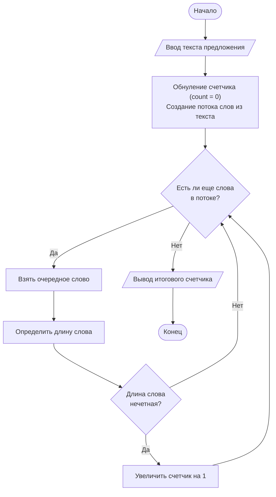

# Лабораторная работа №7: Строки


Репозиторий содержит выполнение лабораторной работы №7 по дисциплине **«Алгоритмизация и программирование»** (ГУАП, Кафедра № 31).

* **Студент:** Уралов А. М. (гр. 3522)
* **Преподаватель:** Нуйя О. С.
* **Дата:** 14.05.2026

## 1. Цель работы
Освоить методы обработки строковых данных в языке C++ с помощью стандартной библиотеки шаблонов (STL), изучить потоковый ввод строк и разделение текста на отдельные слова (лексемы).

## 2. Постановка задачи (Вариант 8)

Дана строка. Определить количество слов, длина которых равняется нечетному числу.

### Алгоритм решения задачи
1. Ввод текстовой строки (предложения) с клавиатуры целиком с учетом пробелов при помощи функции потокового ввода `getline`.
2. Преобразование полученной строки в строковый поток данных (`stringstream`), что позволяет обрабатывать предложение как последовательность отдельных слов.
3. Циклическое извлечение слов из потока до тех пор, пока они не закончатся.
4. Вычисление длины каждого извлеченного слова (`word.length()`).
5. Проверка условия: если остаток от деления длины слова на 2 не равен нулю (`word.length() % 2 != 0`), длина слова является нечетной.
6. Увеличение счетчика `count` на единицу при выполнении условия.
7. Вывод итогового значения счетчика на экран.

## 3. Схема алгоритма



## 4. Исходный код

### Решение на C++ (`src/main.cpp`)

```cpp
#include <iostream>
#include <string>
#include <sstream>

using namespace std;

int main() 
{
    string text;
    string word;
    int count = 0;

    cout << "Введите предложение (только на английском): ";
    if (!getline(cin, text)) return 0;

    stringstream ss(text);

    while (ss >> word) 
    {
        if (word.length() % 2 != 0) 
        {
            count++;
        }
    }

    cout << "Количество слов с нечетной длиной: " << count << endl;

    return 0;
}
```

### Решение на C (`src/main.c`)

```c
#include <stdio.h>
#include <string.h>

#define MAX_LEN 1024

int main(void) 
{
    char text[MAX_LEN];
    int count = 0;

    printf("Введите предложение (только на английском): ");
    if (fgets(text, sizeof(text), stdin) == NULL) return 0;

    const char *delim = " \t\r\n";
    char *word = strtok(text, delim);

    while (word != NULL) 
    {
        if (strlen(word) % 2 != 0) 
        {
            count++;
        }
        word = strtok(NULL, delim);
    }

    printf("Количество слов с нечетной длиной: %d\n", count);

    return 0;
}
```

## 5. Сборка и запуск

```bash
# Сборка и запуск C++
g++ -O2 src/main.cpp -o run_cpp
./run_cpp

# Сборка и запуск C
gcc -O2 src/main.c -o run_c
./run_c
```

## 6. Тестирование программы

| Тест | Входная строка | Разбор длин слов | Результат (`count`) |
| :---: | :--- | :--- | :---: |
| **№1** | `I love C plus plus` | `I` (1), `love` (4), `C` (1), `plus` (4), `plus` (4) | `2` |
| **№2** | `GUAP is best` | `GUAP` (4), `is` (2), `best` (4) | `0` |

## 7. Вывод

В результате выполнения работы были освоены методы обработки строковых данных с помощью стандартной библиотеки шаблонов (STL). Использование класса `stringstream` позволило эффективно разделить входные данные на лексемы (слова) и произвести их анализ согласно условию варианта.