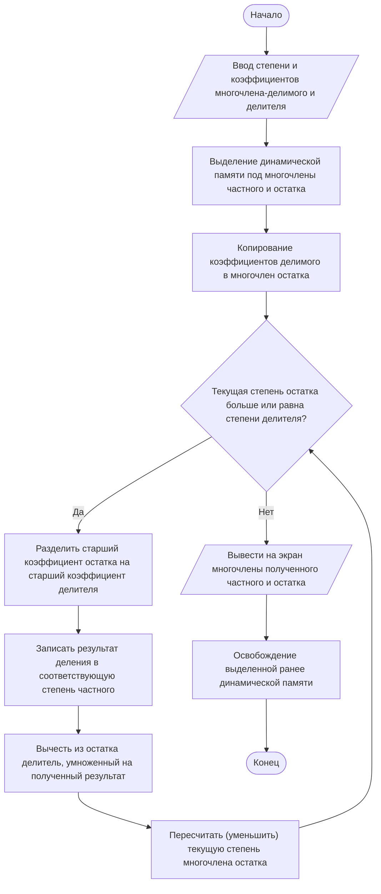

# Лабораторная работа №9. Деление многочленов с динамическим выделением памяти

**Дисциплина:** Алгоритмизация и программирование  
**Вариант:** 8  

## Задание

Ввести степени и коэффициенты двух многочленов $p_1(x)$ и $p_2(x)$. Вычислить и вывести коэффициенты многочленов частного и остатка от деления $p_1(x)$ на $p_2(x)$. Реализовать проект в виде многофайловой структуры (файлы `main9.cpp`, `my_lab9.cpp`, `my_lab9.h`) с динамическим выделением памяти.

## Описание алгоритма и структура проекта

Многочлены представляются динамическими массивами вещественных чисел (`double`), где индекс элемента строго соответствует степени переменной $x$ (например, индекс `3` хранит коэффициент при $x^3$).

Алгоритм реализует деление «уголком»: старший член текущего остатка делится на старший член делителя, формируя очередной коэффициент частного, после чего делитель, умноженный на этот коэффициент, вычитается из остатка. Процесс итерационно продолжается до тех пор, пока степень остатка не станет строго меньше степени делителя.

Проект разделен на три файла в папке `src/`:
1. **`src/my_lab9.h`** — заголовочный файл с объявлениями функций для создания, ввода, вывода и деления многочленов.
2. **`src/my_lab9.cpp`** — реализация выделения памяти, ввода/вывода многочленов и алгоритма деления «уголком».
3. **`src/main9.cpp`** — управляющая программа, отвечающая за взаимодействие с пользователем, вызов функций и очистку динамической памяти.

## Сборка и запуск

```bash
g++ src/main9.cpp src/my_lab9.cpp -o lab9
./lab9
```

## Результаты работы программы (Тестирование)

**Входные данные:**
* Делимое (многочлен 3-й степени): $p_1(x) = 1x^3 - 2x^2 - 4$
* Делитель (многочлен 1-й степени): $p_2(x) = 1x - 3$

**Результат вычислений:**
* Частное: $q(x) = 1x^2 + 1x + 3$
* Остаток: $r(x) = 5$

## Блок-схема



## Вывод

В ходе лабораторной работы был успешно изучен и реализован на практике алгоритм деления многочленов произвольных степеней методом «длинного деления». Были закреплены навыки динамического распределения памяти в языке C++ с помощью оператора `new` и ручной очистки неиспользуемых областей памяти оператором `delete[]` во избежание утечек. Архитектура проекта разделена на три логических файла (интерфейс, реализация, управление), что соответствует стандартам модульного программирования.